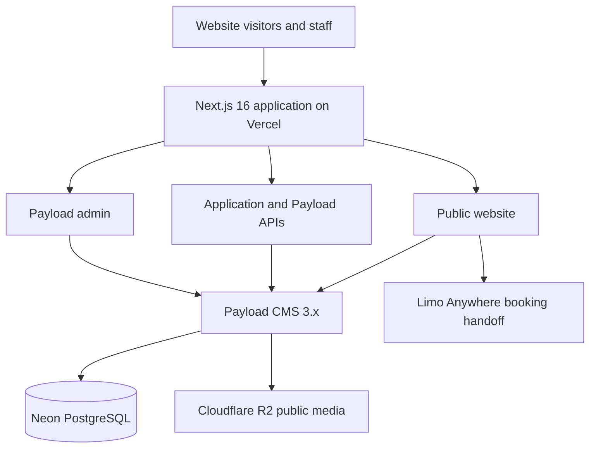
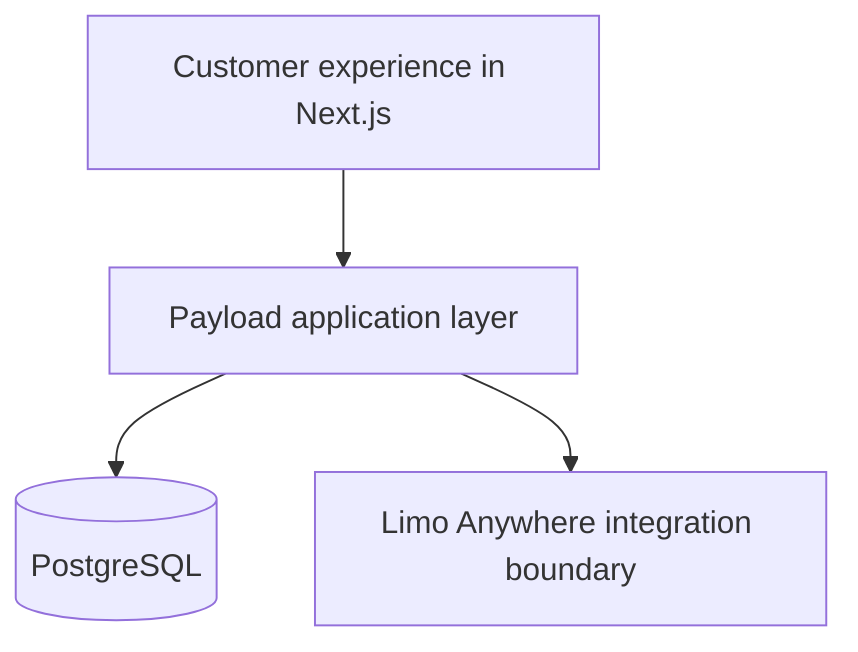
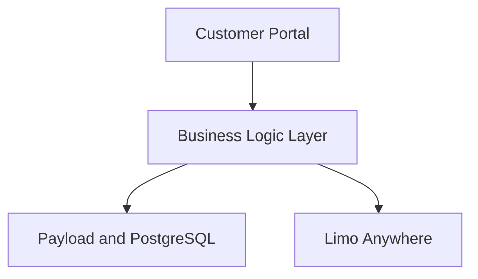
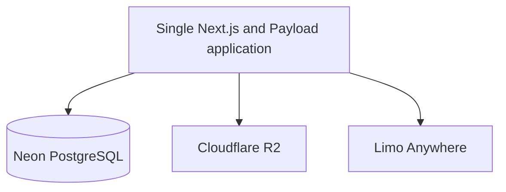
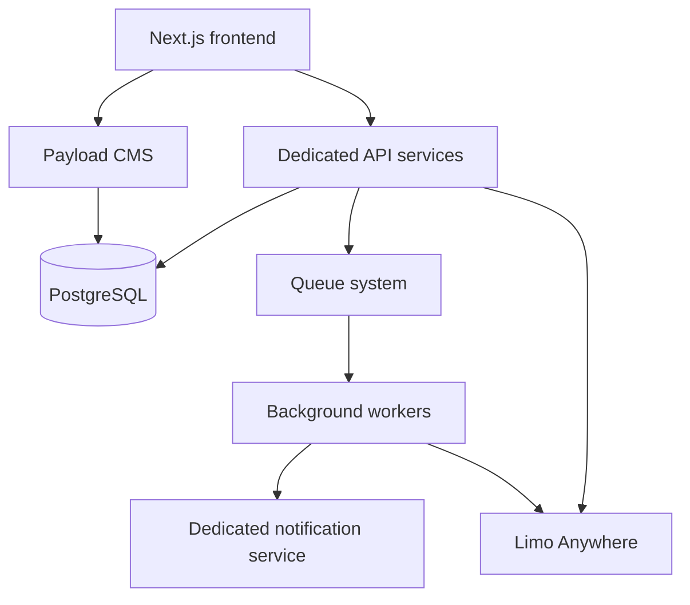

# Future Architecture Roadmap

## Purpose

This document describes how the Your Best Ride Inc. platform can evolve from its current minimum viable product into a larger transportation technology platform. It records system boundaries, architectural decisions, and migration paths only.

The phases below are not implementation commitments. Each phase requires validated business requirements, security review, operational planning, and a separate implementation proposal before development begins.

## Current Production Architecture

The current production architecture is a single Next.js application deployed to Vercel. It contains the public website, Payload CMS, the Payload admin panel, and application API routes under one production domain.

### Frontend

- Next.js 16 App Router
- TypeScript
- Tailwind CSS
- Vercel hosting

### Backend and content management

- Payload CMS 3.x embedded in the Next.js application
- PostgreSQL hosted by Neon
- Payload admin available at `/admin`
- Payload and application API routes hosted in the same deployment

### Storage

- Cloudflare R2 provides S3-compatible object storage for public marketing media.
- Public media includes logos, website images, fleet images, driver profile images, service images, blog media, and approved testimonial imagery.
- Private document uploads are not part of the current architecture.

### Transportation operations

Limo Anywhere remains the transportation operations system and operational source of truth. The website hands customers off to the configured Limo Anywhere booking experience. It does not create or manage reservations internally.

## Current Responsibility Boundaries

### Website platform responsibilities

The custom website platform handles:

- Marketing pages
- Search engine optimization
- Content management
- Public driver showcase profiles
- Public fleet showcase
- Lead capture
- Driver applications

Public driver profiles are marketing records only. They must remain separate from private applicant, employment, operational, or trip records.

### Limo Anywhere responsibilities

Limo Anywhere handles:

- Reservations
- Dispatch
- Driver assignment
- Vehicle assignment
- Trip management
- Driver operations
- Passenger operations

The custom platform must not recreate these capabilities unless a future, explicit business decision replaces Limo Anywhere and includes a dedicated migration and operational continuity plan.

## Phase 2: Customer Experience Expansion

### Possible capabilities

- Customer accounts
- Saved passengers
- Saved locations
- Ride history
- Repeat booking shortcuts
- Customer notifications

### Target architecture

Next.js would provide the customer-facing interface. Payload would provide authentication, authorization, application APIs, and customer-facing data management. PostgreSQL would store approved customer-platform data.

Ride history must not be inferred from marketing leads. If ride history originates in Limo Anywhere, it should be retrieved through a documented integration and normalized into a clearly owned read model only when required. Booking shortcuts should initiate or prefill an approved Limo Anywhere flow rather than create a second reservation system.

Before implementation, this phase requires decisions about identity verification, account recovery, consent, retention, notification preferences, and the exact data ownership boundary with Limo Anywhere.

## Phase 3: Corporate Transportation Portal

### Possible capabilities

- Corporate accounts
- Employee and passenger management
- Recurring ride requests
- Billing reports
- Account dashboards

### Target architecture

The customer portal would present corporate workflows. A business logic layer would enforce tenant boundaries, account permissions, request validation, and integration rules. Payload and PostgreSQL would manage portal accounts and platform-owned records. Limo Anywhere would continue to own reservations and transportation operations.

Recurring ride requests in the portal must not become an independent scheduling or dispatch engine. They should represent customer intent and be transferred to Limo Anywhere through an approved interface. Billing reports must identify their authoritative source; operational charges and completed-trip data should remain aligned with Limo Anywhere or the designated financial system.

This phase requires tenant isolation, role-based access, audit trails, data retention rules, and a reconciliation strategy for cross-system records.

## Phase 4: Medical Facility Portal

### Possible capabilities

- Healthcare facility accounts
- Patient transportation requests
- Recurring appointment schedules
- Facility reporting

### Target boundary

The facility portal may collect and manage transportation requests, but Limo Anywhere remains responsible for reservation execution, dispatch, assignments, and trip operations. Recurring appointment schedules must be treated as facility request data until accepted into the operational system.

### Healthcare data requirement

Healthcare privacy, security, contractual, and regulatory requirements must be reviewed separately before the platform stores, processes, or transmits protected health information or other sensitive medical data.

The current lead forms and platform architecture are not a declaration of HIPAA compliance and must not be extended to collect diagnoses, medical records, insurance details, or other protected health information without a dedicated assessment. That assessment must cover, at minimum:

- Whether protected health information is necessary
- Data minimization and purpose limitation
- Vendor eligibility and required agreements
- Encryption and key management
- Authentication and authorization
- Audit logging
- Retention and deletion
- Incident response
- Backup and restoration
- Secure integrations with Limo Anywhere and facility systems

No medical facility feature should enter implementation until those requirements and system responsibilities are approved.

## Phase 5: Driver Portal

### Possible capabilities

- Driver onboarding
- Document management
- Availability preferences
- Communication tools

### Operational boundary

The driver portal should not replace Limo Anywhere driver operations. Limo Anywhere remains the operational source of truth for active drivers, assignments, vehicles, trips, dispatch, and operational availability.

A future portal may improve onboarding and communication while maintaining explicit boundaries between:

- Public driver showcase profiles
- Private driver application records
- Onboarding and document records
- Limo Anywhere operational driver records

Document management would require private object storage, authenticated file delivery, malware scanning, retention policies, access auditing, and documented deletion procedures. It must not use the current public R2 media bucket.

Availability preferences may be collected for administrative review or synchronized through an approved integration, but they must not be presented as live operational availability unless Limo Anywhere provides and owns that state.

## Phase 6: Platform Scaling

### Current architecture

The single-application architecture minimizes deployment, integration, and operational complexity for the current scope. The public website, CMS, admin panel, and APIs share one Next.js deployment while preserving logical module and access-control boundaries.

### Possible future architecture

A scaled architecture may separate:

- **Frontend:** Next.js for public and authenticated user experiences
- **Backend:** Dedicated API services for domain workflows and integrations
- **CMS:** Payload for editorial content and approved administrative workflows
- **Database:** PostgreSQL with explicit schemas or service ownership boundaries
- **Background jobs:** A durable queue and workers for asynchronous processing
- **Notifications:** A dedicated service for email, SMS, delivery status, and preferences

### Migration path

1. Preserve clear modules inside the single application before extracting services.
2. Identify scaling, security, reliability, or team-ownership constraints using production evidence.
3. Define authoritative data ownership and API contracts for the module being extracted.
4. Introduce an internal API boundary while the module remains in the existing application.
5. Move long-running or retryable work to a durable queue before creating independent services where appropriate.
6. Extract one bounded capability at a time, retaining compatibility during migration.
7. Add observability, idempotency, reconciliation, and rollback procedures for every cross-system workflow.
8. Remove the previous path only after data and behavior have been verified in production.

Service extraction should not be driven solely by anticipated growth. The single deployment should remain in place until measurable requirements justify additional operational complexity.

## Architecture Principles

1. **Do not duplicate Limo Anywhere functionality.** Reservations, dispatch, assignments, trip management, and transportation operations remain in Limo Anywhere.
2. **Keep operational data separate from marketing data.** Marketing content and leads must not become an unofficial operational database.
3. **Keep public profiles separate from private records.** Public driver and fleet presentations must not expose applicant, employment, contact, document, availability, or trip data.
4. **Add complexity only when business requirements justify it.** New services, queues, databases, and integrations require a demonstrated need and an ownership plan.
5. **Protect sensitive healthcare information.** Do not collect protected health information without an approved legal, security, privacy, and vendor architecture.
6. **Maintain API boundaries between systems.** Integrations must use documented contracts, authentication, validation, idempotency, observability, and explicit data ownership.

## Architecture Decisions

### Limo Anywhere is the operations system

Limo Anywhere already provides the specialized workflows required to run transportation operations. Keeping it as the operational source of truth avoids building a second dispatch and reservation platform, reduces operational risk, and prevents conflicting driver, vehicle, passenger, or trip records.

The custom platform focuses on customer acquisition, content, and carefully bounded portal experiences. Any future integration should exchange only the data required by an approved workflow and should include reconciliation rules.

### Payload manages content and leads

Payload provides a typed, application-integrated CMS with editorial workflows, authentication, role-based access, and PostgreSQL-backed collections. It is appropriate for marketing content, public profiles, lead records, driver applications, and controlled administrative workflows.

Payload lead records represent acquisition and follow-up activity. They are not reservations, trips, dispatch records, or proof that transportation has been scheduled.

### A single deployment was selected

The MVP uses one Next.js 16 application for the public website, Payload CMS, admin panel, and API routes. This reduces deployment overhead, removes unnecessary network boundaries, and allows server-side code to use shared types and application services without exposing credentials to the browser.

Logical security boundaries remain necessary inside the deployment. Public routes, authenticated administration, private intake data, and server-only integrations must retain separate authorization and data-access rules. A single deployment does not mean unrestricted access between browser and server concerns.

### Neon PostgreSQL was selected

Neon provides managed PostgreSQL suitable for the Vercel-hosted application, including secure connections and database branching that can support migration testing. PostgreSQL is also the supported persistence layer for Payload collections, authentication, versions, relationships, and application records.

Production schema changes must use reviewed Payload migrations. Automatic schema synchronization must remain disabled in production. Database branching does not replace backups, migration review, controlled execution, or restoration testing.

### Cloudflare R2 was selected

Cloudflare R2 provides cost-efficient, S3-compatible object storage for public marketing media. Payload can use its S3-compatible adapter while the public website consumes media through an approved public domain.

The current bucket is limited to public marketing assets. Future sensitive documents require separate private storage, authenticated delivery, access logging, retention controls, and security review; they must not be placed in the public media bucket.

## Change Governance

Before beginning any roadmap phase:

1. Approve the business requirement and measurable outcome.
2. Confirm which system owns each new record and state transition.
3. Review privacy, security, retention, and regulatory implications.
4. Define integration contracts with Limo Anywhere and other providers.
5. Document migration, reconciliation, failure handling, and rollback.
6. Update architecture decisions when a boundary or source of truth changes.

This roadmap should be revised when approved requirements change, but future implementation should continue to respect the system boundaries and architecture principles documented here.
