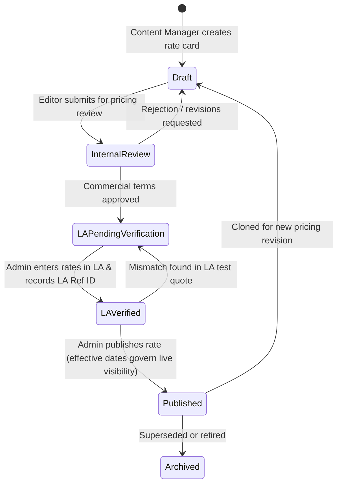
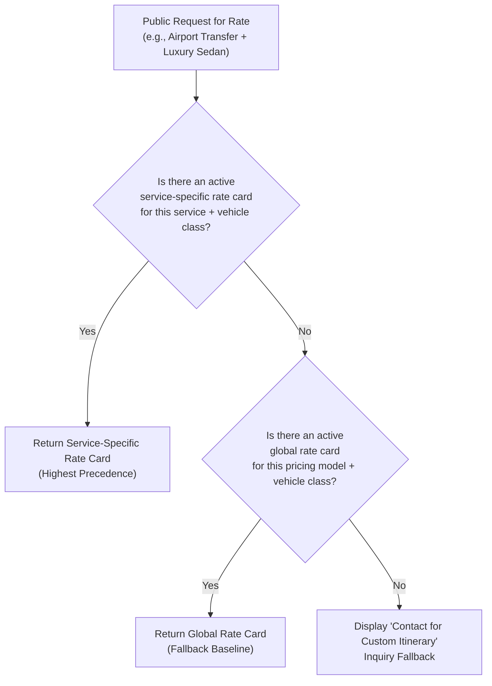

# Your Best Ride — CMS-Managed Rates & Options Architecture (Final Specification)

> [!IMPORTANT]
> **FINAL ARCHITECTURAL SPECIFICATION — APPROVED IN PRINCIPLE**
> This document incorporates all confirmed decisions from stakeholder review and defines the definitive technical and operational architecture for the Your Best Ride Inc. CMS-managed pricing system.
> **Implementation Status:** Pre-implementation architecture complete. Phase 1 ready for execution upon developer greenlight. No code modifications, migrations, or production deployments have been executed during this task.

---

## 1. Executive Summary & Core Architectural Principles

Your Best Ride Inc. operates a competitive-premium chauffeured transportation service utilizing a hybrid fulfillment model (own-fleet and certified affiliate partners) powered by **Next.js 16 (App Router)**, **Payload CMS 3 (Neon PostgreSQL)**, and **Limo Anywhere (LA)**.

### Architectural Principles

1. **Dual System of Record with Strict Separation of Concerns:**
   - **Payload CMS** is the authoritative source of truth for **Marketing & Public Pricing** (published customer tariffs, route rate cards, hourly policies, mileage formulas, fee disclosures, and vehicle class marketing).
   - **Limo Anywhere (LA)** is the authoritative operational source of truth for **Billing, Dispatch, and Financial Transactions** (live trip reservations, card authorizations, driver dispatches, actual GPS-measured toll/wait billing).
   - *No customer-facing price may go live on the public website without audited, documented reconciliation against Limo Anywhere rate tables.*

2. **Universal Customer Tariff:**
   - In accordance with Requirement 9, a single published customer tariff governs both own-fleet and affiliate-dispatched bookings. The customer receives consistent, transparent pricing regardless of behind-the-scenes fulfillment dispatching.

3. **Deterministic Conflict Resolution:**
   - Overlapping rates, competing geographic boundaries, and concurrent publishing actions are resolved deterministically using a multi-dimensional hierarchy enforced at both the database and application levels.

4. **Zero-Downtime Additive Migrations:**
   - All schema enhancements are strictly non-breaking and additive. Existing fleet vehicles, published services, and intake lead forms remain intact with zero downtime.

5. **Configurable Business Policies vs. Statutory Mandates:**
   - The system strictly distinguishes between statutory regulatory fees (NYS Congestion Surcharge, MTA CBD Tolling, Port Authority fees) and company commercial policies (pickup grace periods, waiting rates, deadhead thresholds, late-night surcharges). Commercial policies are fully configurable in Payload CMS without code deployments.

---

## 2. Limo Anywhere Reconciliation Workflow & Unified State Machine

Because Payload CMS and Limo Anywhere operate as distinct systems without an automated bidirectional API sync in this phase, pricing synchronization is governed by an **audited, human-in-the-loop state machine** enforced directly within Payload CMS hooks and field-level permissions.



### 2.1 Unified State Definitions

| State Slug | Display Label | Allowed Roles | Description & Gate Requirements |
|---|---|---|---|
| `draft` | Draft | `admin`, `content-manager` | Initial rate compilation. May contain incomplete route tables or formulas. Hidden from public API. |
| `internal_review` | Under Internal Review | `admin`, `content-manager` | Rates submitted for commercial review (margins, vehicle class alignment, partner feasibility). |
| `la_pending_verification` | Pending LA Verification | `admin` | Commercial review passed. Rates dispatched to operations to configure matching rate matrices/fixed routes in Limo Anywhere. |
| `la_verified` | LA Verified & Reconciled | `admin` only | Operational administrator has run live test quotes in Limo Anywhere and confirmed 100% parity with CMS rates. Requires recording `laReferenceCode`, `reconciliationNotes`, `verifiedBy`, and `verifiedAt`. Supporting screenshot optional. |
| `published` | Published / Active | `admin` only | Public-facing status. Live once `effectiveFrom` timestamp is reached. Must have passed `la_verified`. |
| `archived` | Archived / Retired | `admin` only | Superseded by a newer rate card or discontinued. Retained for audit and booking history lookup. |

### 2.2 Single Public Visibility Condition

To guarantee that unreconciled or draft prices never leak to the public, a rate card document is visible to unauthenticated public visitors **if and only if all of the following conditions are simultaneously met**:

1. `_status === 'published'` (Payload collection document version status)
2. `reconciliation.status === 'published'` (Internal reconciliation state)
3. `reconciliation.laReferenceCode` is populated with a valid string ($\ge 3$ characters)
4. `reconciliation.verifiedBy` (User FK) and `reconciliation.verifiedAt` (timestamp) are populated
5. Time validity: `effectiveFrom <= now` AND (`effectiveTo` is null OR `effectiveTo > now`)

If any of these conditions fail, the rate card is omitted from public queries and view models.

### 2.3 Reconciliation Audit Fields on `rate-cards`

```typescript
{
  name: 'reconciliation',
  type: 'group',
  admin: {
    position: 'sidebar',
    description: 'Mandatory Limo Anywhere operational audit trail. Required before publication.',
  },
  fields: [
    {
      name: 'status',
      type: 'select',
      required: true,
      defaultValue: 'draft',
      options: [
        { label: '1. Draft',                    value: 'draft' },
        { label: '2. Under Internal Review',    value: 'internal_review' },
        { label: '3. Pending LA Verification',  value: 'la_pending_verification' },
        { label: '4. LA Verified & Reconciled', value: 'la_verified' },
        { label: '5. Published / Active',       value: 'published' },
        { label: '6. Archived',                 value: 'archived' },
      ],
      access: {
        update: ({ req: { user } }) => hasRole(user, ['admin']),
      },
    },
    {
      name: 'laReferenceCode',
      type: 'text',
      admin: {
        description: 'Mandatory: Limo Anywhere Rate Matrix ID, Fixed Rate Table Code, or Verification Quote #',
        condition: (data) => ['la_verified', 'published'].includes(data?.reconciliation?.status),
      },
      validate: (val, { siblingData }) => {
        if (['la_verified', 'published'].includes(siblingData?.status) && (!val || val.trim().length < 3)) {
          return 'A valid Limo Anywhere reference ID/code is mandatory for verified or published rates.';
        }
        return true;
      },
    },
    {
      name: 'reconciliationNotes',
      type: 'textarea',
      admin: {
        description: 'Mandatory audit notes: Detail the test quote executed in LA (e.g., "Test quote #10482 JFK->Manhattan matched $145 base + $2.75 NYS fee").',
        condition: (data) => ['la_verified', 'published'].includes(data?.reconciliation?.status),
      },
      validate: (val, { siblingData }) => {
        if (['la_verified', 'published'].includes(siblingData?.status) && (!val || val.trim().length < 10)) {
          return 'Audit notes detailing the Limo Anywhere test verification are mandatory.';
        }
        return true;
      },
    },
    {
      name: 'verificationScreenshot',
      type: 'upload',
      relationTo: 'media',
      admin: {
        description: 'Optional: Upload a screenshot or PDF receipt of the verified Limo Anywhere test quote.',
        condition: (data) => ['la_verified', 'published'].includes(data?.reconciliation?.status),
      },
    },
    {
      name: 'verifiedBy',
      type: 'relationship',
      relationTo: 'users',
      admin: {
        readOnly: true,
        condition: (data) => Boolean(data?.reconciliation?.verifiedBy),
      },
    },
    {
      name: 'verifiedAt',
      type: 'date',
      admin: {
        readOnly: true,
        date: { pickerAppearance: 'dayAndTime' },
        condition: (data) => Boolean(data?.reconciliation?.verifiedAt),
      },
    },
  ],
}
```

### 2.4 Hard Publication Gate Hook

The `beforeChange` hook on `rate-cards` enforces the reconciliation gate at the server level:

```typescript
export const enforceReconciliationGate: CollectionBeforeChangeHook = async ({ data, req }) => {
  if (data._status === 'published') {
    const rec = data.reconciliation || {};
    
    // Gate 1: Check reconciliation state
    if (rec.status !== 'la_verified' && rec.status !== 'published') {
      throw new ValidationError([{
        field: 'reconciliation.status',
        message: 'Cannot publish rate card: Rate card must be marked "LA Verified & Reconciled" before publishing.',
      }]);
    }

    // Gate 2: Mandatory LA Reference Code
    if (!rec.laReferenceCode || rec.laReferenceCode.trim().length < 3) {
      throw new ValidationError([{
        field: 'reconciliation.laReferenceCode',
        message: 'Cannot publish rate card: An audited Limo Anywhere Reference Code is mandatory.',
      }]);
    }

    // Gate 3: Mandatory Audit Notes
    if (!rec.reconciliationNotes || rec.reconciliationNotes.trim().length < 10) {
      throw new ValidationError([{
        field: 'reconciliation.reconciliationNotes',
        message: 'Cannot publish rate card: Verification audit notes detailing the LA test quote are mandatory.',
      }]);
    }

    // Gate 4: Admin Role Required for Publication
    if (!hasRole(req.user, ['admin'])) {
      throw new ValidationError([{
        field: '_status',
        message: 'Unauthorized: Only an Administrator can approve and publish live pricing tariffs.',
      }]);
    }

    // Stamp audit metadata and synchronize status
    data.reconciliation.verifiedBy = data.reconciliation.verifiedBy || req.user?.id;
    data.reconciliation.verifiedAt = data.reconciliation.verifiedAt || new Date().toISOString();
    data.reconciliation.status = 'published';
  }

  return data;
};
```

---

## 3. Conflict Prevention, Advisory Locks & Database Constraints

Multi-model pricing requires deterministic handling of overlapping effective dates, service scopes, and concurrent administrator publishing actions.

### 3.1 Dimensions of Rate Uniqueness

Rate uniqueness is evaluated across six dimensions:
1. `vehicleClass` (Foreign Key to `vehicle-classes`)
2. `pricingModel` (`fixed` | `hourly` | `mileage` | `custom`)
3. `serviceScope` (`global` vs `service-specific`)
4. `serviceId` (Nullable Foreign Key to `services`; set if `serviceScope === 'service_specific'`)
5. `routeSignature` (For fixed routes: unique combination of origin and destination zones)
6. `effectiveDateRange` (`[effectiveFrom, coalesce(effectiveTo, 'infinity'))`)

### 3.2 Precedence Rules: Global vs. Service-Specific Tariffs



- **Rule 1 (Shadowing):** A published **service-specific** rate card explicitly overrides the **global** rate card for that specific service. They may have overlapping effective dates without conflict because their evaluation order is deterministic.
- **Rule 2 (Global Exclusivity):** Only **one** global rate card per `(vehicleClass, pricingModel)` may be active at any single point in time.
- **Rule 3 (Service Exclusivity):** Only **one** service-specific rate card per `(vehicleClass, pricingModel, serviceId)` may be active at any single point in time.
- **Rule 4 (Fixed Route Specificity):** Within a fixed route rate card, if two routes share identical origin and destination zones, the rate card validation rejects the duplicate route row.

### 3.3 Stack Integration: Advisory Locks, Exclusion Constraints & Transactions

Neon PostgreSQL, Drizzle ORM, and Payload 3 work together through a two-layer concurrency and uniqueness strategy:

#### Layer 1: PostgreSQL Advisory Transaction Locks (Immediate Concurrency Protection)
Payload 3 executes database writes within a PostgreSQL transaction (`payload.db.drizzle.transaction`). During the execution of the `beforeChange` publication hook, Payload acquires a transaction-scoped advisory lock derived from the unique hash of the vehicle class and pricing model:

```typescript
// Acquired inside the Payload Postgres transaction
await payload.db.drizzle.execute(sql`
  SELECT pg_advisory_xact_lock(hashtext(${`rate_cards_${data.vehicleClass}_${data.pricingModel}_${data.serviceScope || 'global'}`}))
`);
```
- **How it works:** `pg_advisory_xact_lock` serializes concurrent publish attempts for the same vehicle class and model. The second transaction must wait until the first commits or rolls back, guaranteeing that the second transaction sees the first transaction's published record during its date-overlap check.
- **Connection Pool Compatibility:** Because this lock is transaction-scoped (`_xact_lock`), it is 100% compatible with Neon's PgBouncer transaction-mode connection pooler and releases automatically when the transaction completes.

#### Layer 2: PostgreSQL Partial Exclusion Constraint (Database-Level Invariant)
To provide an absolute database-level guarantee against data corruption, Neon PostgreSQL applies a physical exclusion constraint via the `btree_gist` extension:

```sql
-- Executed via Neon Schema Migration (using direct connection, not transaction pooler)
CREATE EXTENSION IF NOT EXISTS btree_gist;

ALTER TABLE rate_cards
ADD CONSTRAINT exclude_overlapping_global_rates
EXCLUDE USING gist (
  vehicle_class_id WITH =,
  pricing_model WITH =,
  tstzrange(
    effective_from, 
    COALESCE(effective_to, 'infinity'::timestamptz), 
    '[)'
  ) WITH &&
)
WHERE (
  _status = 'published' 
  AND service_scope = 'global'
);
```

### 3.4 Concurrency & Date Overlap Regression Test Plan

Before release, automated tests in `apps/web/tests/pricing-conflict.test.ts` verify:
1. **Parallel Publish Race:** Two simultaneous publish requests for overlapping dates on the same vehicle class. Verification: Exactly one succeeds; the second receives a clean 400 `ValidationError`.
2. **Back-to-Back Effective Dates:** Card A (`effectiveTo = 2026-12-31T23:59:59Z`) and Card B (`effectiveFrom = 2027-01-01T00:00:00Z`). Verification: Both publish successfully with zero conflict.
3. **Shadowing Co-existence:** Global rate card and Service-Specific rate card active concurrently. Verification: Both publish successfully; service detail page renders the service-specific rate.

---

## 4. Mileage Pricing Architecture (Phase 1 Scope)

### 4.1 Phase 1 Implementation Scope: Informational Pricing & Quotation Intake

- **Decision Confirmed:** Phase 1 uses **informational pricing formulas, sample route benchmarks, and a direct quotation CTA** (`TransportationInquiryForm` and `/book`).
- **No Public Google Maps Calculator in Phase 1:** Client-side dynamic route distance matrix calculations are deferred. Dynamic mileage estimation requires finalized rates and real operating cost validation before automated calculations can be exposed publicly.
- **Phase 1 Presentation:** The `/rates-and-options` page and service detail pages present clear, transparent pricing formulas alongside illustrative mileage benchmarks (e.g., 25-mile, 50-mile, 75-mile trip estimates).
- **Customer Disclosure:** *"Mileage fares are calculated based on dispatched route miles, vehicle staging, and travel conditions. Final reservations and binding quotes are provided via our online reservation system or by requesting a custom quote."*

### 4.2 Validated Mileage Formula Specification

$$\text{Estimated Fare} = \max\left(\text{MinimumFare}, \; \text{BaseFare} + (\text{BillableDistance} \times R_{\text{dist}}) + (\text{BillableDuration} \times R_{\text{time}}) + \text{DeadheadFee} + \sum \text{ConditionalFees}\right)$$

Where:
- $\text{BaseFare}$ ($): Initial dispatch/flag-drop fee covering vehicle staging and initial administrative cost.
- $R_{\text{dist}}$ ($/mile): Exact per-mile rate determined by vehicle class.
- $R_{\text{time}}$ ($/minute): Time component compensating for metropolitan traffic delays.
- $\text{MinimumFare}$ ($): Absolute revenue floor for any dispatch in this vehicle class.
- $\text{DeadheadFee}$ ($): Repositioning fee for long-distance pickups or out-of-territory drop-offs.

### 4.3 Configurable Mileage Policies

These parameters are modeled as configurable business settings on the `rate-cards` schema:
- `deadheadThresholdMiles`: Default 35 miles from primary vehicle base.
- `deadheadRatePerMile`: Specific rate charged for each mile beyond the threshold ($R_{\text{deadhead}}$).
- `complimentaryWaitMinutes`: Default 15 minutes for curbside pickups.
- `waitingRatePerHour`: Overtime hourly rate for excessive wait time.

---

## 5. Congestion Charges, Statutory Surcharges & Fee Modeling

Universal blanket statements such as *"All taxes and gratuities excluded"* are legally inadequate. Statutory fees and company surcharges are modeled conditionally with strict mutual exclusion to prevent double-counting.

### 5.1 Distinct Modeling of NYS Congestion & MTA CBD Tolling

| Fee Identifier | Legal / Regulatory Authority | Geographic Boundary | Trigger Condition | Rate Type | Amount / Basis |
|---|---|---|---|---|---|
| `nys_congestion_surcharge` | NY State Tax Law § 1281 | Manhattan south of 96th Street | Any trip starting in, ending in, or passing through Manhattan south of 96th St | Statutory Flat Surcharge | **$2.75** per trip (for-hire passenger vehicles) |
| `mta_cbd_tolling` | MTA Central Business District Tolling Program | Manhattan Central Business District (south of 60th Street) | Vehicle enters the Congestion Relief Zone from north of 60th St or via bridges/tunnels | Statutory Toll Pass-Through | Prevailing MTA CBD Tolling schedule (peak/off-peak) |
| `panynj_airport_access` | Port Authority of NY & NJ Ground Transportation Rules | JFK, LGA, EWR airport property | Pickup or drop-off at airport commercial passenger terminals | Statutory Flat Fee | **$2.50 – $5.00** per airport entry |
| `commercial_tolls` | Port Authority / MTA / NY State Thruway | Incurred bridges, tunnels, turnpikes | Vehicle transits a tolled crossing (RFK, Lincoln, Holland, Verrazzano) | Actual Pass-Through | Exact EZPass commercial toll rate |

### 5.2 Prevention of Duplicate or Incorrect Fee Application

1. **Separate Line-Item Breakdown:** Where an actual price estimate or quote is displayed, fees are broken out separately rather than lumped into a generic surcharge.
2. **Mutual Exclusion & Boundary Verification:**
   - A trip operating **entirely within Brooklyn or Queens** incurs $0.00 NYS Congestion Surcharge and $0.00 MTA CBD Toll.
   - A trip from **Uptown (110th St) to Midtown (50th St)** incurs the $2.75 NYS Congestion Surcharge (south of 96th St) and the MTA CBD Toll (entering south of 60th St). Both apply legitimately as separate statutory charges and are presented as distinct line items.
   - A trip operating **entirely within the CBD (e.g., 40th St to Wall St)** incurs the $2.75 NYS Congestion Surcharge, but does **not** incur the MTA CBD entry toll (since the vehicle does not cross the perimeter boundary into the zone).

### 5.3 Configurable Commercial Policies (Non-Statutory)

The following company commercial policies are managed in Payload CMS:
- **Late-Night Dispatch Surcharge:** Flat $20.00 – $35.00 surcharge for pickups between 23:00 and 05:00 local time.
- **Additional Stop Fee:** Flat $25.00 – $40.00 per intermediate stop (< 15 mins).
- **Child Safety Seat Fee:** Flat $25.00 sanitization and installation fee per seat.
- **VIP Meet & Greet:** Flat $35.00 – $50.00 + parking fee for terminal baggage claim chauffeur greeting.

---

## 6. Access Control & Permission Matrix

Payload access controls enforce strict separation between rate authors and rate approvers to guarantee rate integrity.

### 6.1 Role Permission Hierarchy

```
[admin]              ── Full write, approve, reconcile, publish, and delete authority
  │
[content-manager]    ── Draft preparation, route data entry (cannot verify or publish)
  │
[lead-manager]       ── Zero access to pricing collections
  │
[public / guest]     ── Read published + active + reconciled rate cards only
```

### 6.2 Detailed Collection Permission Matrix

| Collection / Global | Action | `public` / Unauthenticated | `content-manager` | `admin` |
|---|---|---|---|---|
| `vehicle-classes` | Read | Published only | All | All |
| `vehicle-classes` | Create / Update | Denied | Allowed | Allowed |
| `vehicle-classes` | Publish | Denied | Denied | Allowed |
| `vehicle-classes` | Delete | Denied | Denied | Allowed |
| `rate-cards` | Read | Active Published Only | All | All |
| `rate-cards` | Create / Edit Draft | Denied | Allowed | Allowed |
| `rate-cards` | Verify LA Sync | Denied | Denied | Allowed |
| `rate-cards` | Publish | Denied | Denied | Allowed |
| `rate-cards` | Delete (Hard) | Denied | Denied | Allowed |
| `pricing-settings` | Read | Published Only | All | All |
| `pricing-settings` | Update | Denied | Denied | Allowed |

---

## 7. Next.js 16 & Payload Cache Lifecycle Architecture

### 7.1 Verified Repository Caching Mechanics

- **Local Execution:** Server components use `requestLocalPayload()` delegating to `payload.find()`. Payload Local API **does NOT accept** `next: { tags }`.
- **Render Deduplication:** `React.cache()` in `queries.ts` provides per-request deduplication only.
- **On-Demand Path Revalidation:** Cross-request cache invalidation is handled by `revalidatePath` inside `path-revalidation.ts`, triggered by Payload's `afterChange` and `afterDelete` collection hooks.

### 7.2 Cache Revalidation Routes for Rates

When a `rate-cards` or `vehicle-classes` record is published, updated, or deleted, the hook triggers:
- `revalidatePath('/rates-and-options')`
- `revalidatePath('/services', 'page')`
- `revalidatePath('/fleet', 'page')`
- `revalidatePath('/services/[slug]', 'page')` (for all linked service slugs)

### 7.3 Realistic Timing Expectations Around Effective Dates (ISR Propagation)

1. **Acceptable ISR Latency Window (0 to 300 Seconds):**
   Public routes declare:
   ```typescript
   export const revalidate = 300; // 5-minute background ISR
   ```
   **Truth in Timing:** With background ISR, rate transitions occurring at `effectiveFrom` or `effectiveTo` timestamps will take **between 0 and 300 seconds (up to 5 minutes)** to propagate to all edge caches on incoming traffic. **The architecture does not claim instantaneous, exact-second activation via ISR alone.**

2. **Immediate Manual Invalidation Option:**
   For high-profile tariff launches (e.g., press release or scheduled midnight rate changeover), administrators can trigger the authenticated endpoint:
   `POST /api/revalidate` with body `{ "tags": ["cms:rate-cards"] }`
   This instantly purges edge caches and eliminates the 5-minute ISR delay.

---

## 8. Frontend Specification: Central Rates Page & Service Detail Pages

### 8.1 Central Route: `/rates-and-options`

- **Accessible Tabbed Switcher:**
  1. **Airport & Point-to-Point (Fixed Routes):** Tabular route matrix with Origin, Destination, Vehicle Class selector, Base Rate, and Included Amenities.
  2. **Hourly Chauffeur (As-Directed):** Hourly rate comparison grid highlighting minimum booking hours, overtime terms, and flexibility.
  3. **Mileage-Based Travel (Regional):** Clear informational formula breakdown showing Flag Drop, Per-Mile Rate, and Estimated Route Calculations.
  4. **Special Events & Custom:** Weddings, corporate roadshows, and executive delegations with direct quotation intake.
- **CMS-Driven Vehicle Class Grid:**
  - Dynamic comparison grid generated from published `vehicle-classes` records.
  - Adding a new vehicle class in Payload CMS renders it on the comparison grid automatically without a frontend code deployment.
- **Comprehensive Disclosures:**
  - Contextual statutory fee breakdown (NYS Congestion, MTA CBD, Airport access fees, Toll policy).
  - Universal Customer Tariff assurance (same price for own-fleet and affiliate fulfillment).
- **Direct Booking CTA:**
  - Directs to `/book?vehicleClass=[slug]&service=[service-slug]`, preserving the existing, tested Limo Anywhere ORES widget integration.

### 8.2 Service Detail Pages: `/services/[slug]`

- **Automated Starting Price Derivation:**
  - The "Starting From" price is **strictly derived from eligible published rate cards** linked to that service (e.g., lowest fixed route rate, or minimum hourly charter fee).
  - **No Manual Numerical Override:** Editors cannot manually type a dollar figure. This guarantees that starting rates advertised on service pages never contradict published rate cards.
  - **Clear Pricing Basis:** Badges clearly state the basis: *"Starting from $145 (Executive Sedan JFK Airport Transfer)"* or *"Starting from $95/hr (2-hr minimum, Luxury Sedan)"*.
  - Editors can configure display titles and descriptive notes, but the dollar figure is computed mathematically.
- **Preserved Existing Components:**
  - Existing `TransportationInquiryForm` ("Request a Custom Quote") and `LimoAnywhereBooking` handoff buttons remain completely functional.

---

## 9. Migration Risk Assessment & Rollback Plan

### 9.1 Risk Assessment Matrix

| Risk Factor | Severity | Probability | Mitigation Strategy |
|---|---|---|---|
| Accidental table lock on production database | High | Low | Run all DDL migrations during scheduled maintenance window using explicit non-blocking DDL (`ADD COLUMN ... NULL`). Never run `DATABASE_PUSH=true`. |
| Breaking changes to existing `services` or `fleet_vehicles` | High | Negligible | All schema additions are strictly non-destructive: nullable foreign keys and defaulted boolean flags. |
| Incompatible GiST exclusion constraint on connection pooler | Medium | Low | Execute DDL migration via direct Neon connection string (`DATABASE_DIRECT_URI`), bypassing PgBouncer transaction-mode connection pooler. |
| Stale pricing displayed after rate update | Low | Low | On-demand path revalidation triggers immediately on save; 5-minute ISR window provides reliable fallback. |

### 9.2 Step-by-Step Rollback Plan

If an unforeseen schema or runtime failure occurs during release:

1. **Database Rollback:**
   - Execute the rollback migration:
     `pnpm --filter @yourbestride/web payload migrate:down`
   - Drops `rate_cards`, `vehicle_classes`, and removes additive columns `fleet_vehicles.vehicle_class_id` and `services.pricing_display_*`.
   - Existing tables and rows in `fleet_vehicles`, `services`, and `locations` remain untouched.
2. **Neon Point-in-Time Recovery (PITR):**
   - If database corruption occurs, Neon PITR allows restoring the database to the exact second prior to migration execution.
3. **Application Rollback:**
   - Redeploy the previous Git commit. The application operates normally against the existing schema.

---

## 10. Phase 1 Implementation Scope & Checklist

Phase 1 establishes the complete database schema, administrative workflow, reconciliation enforcement, and backend query layer.

### Phase 1 Deliverables (Ready for Implementation)

- [ ] **Step 1: Staging Environment Isolation:**
  - Create Neon PostgreSQL staging branch (`br-pricing-staging`).
  - Configure staging environment variables.
- [ ] **Step 2: Schema Creation (Additive):**
  - Create `apps/web/src/collections/VehicleClasses.ts`.
  - Create `apps/web/src/collections/RateCards.ts` (with unified reconciliation group).
  - Create `apps/web/src/globals/PricingSettings.ts`.
  - Add nullable `vehicleClass` FK to `fleet-vehicles` in `Editorial.ts`.
  - Add `pricingDisplay` group (with automated starting price logic) to `services` in `Editorial.ts`.
- [ ] **Step 3: Migration Execution & Testing:**
  - Run `pnpm --filter @yourbestride/web payload migrate:create add_pricing_engine`.
  - Validate SQL migration script against Neon staging branch.
  - Apply migration to staging database.
- [ ] **Step 4: Lifecycle Hooks & Advisory Locks:**
  - Implement `rate-card-hooks.ts` containing `enforceReconciliationGate`, `validateRateCardDates`, and `pg_advisory_xact_lock` concurrency protection.
  - Register hooks on `rate-cards` collection.
- [ ] **Step 5: Automated Regression Testing:**
  - Execute automated tests covering reconciliation gates, date overlap rejections, and advisory lock serialization.
- [ ] **Step 6: Data Seeding & Admin Verification:**
  - Seed initial `vehicle-classes` (Executive Sedan, Luxury Sedan, Full-Size SUV, Executive Sprinter).
  - Map existing fleet vehicles to vehicle classes.
  - Input draft rate cards and conduct test reconciliation verification.

---

## 11. Remaining Blockers & Status Review

All architectural questions and stakeholder decisions have been resolved and incorporated:

| Item | Status | Resolution |
|---|---|---|
| Limo Anywhere reconciliation workflow | **RESOLVED** | Mandatory reference code, audit notes, verifiedBy/At; optional screenshot; hard publication gate. |
| Mileage pricing scope | **RESOLVED** | Phase 1 uses informational formula breakdowns and quote CTAs; dynamic calculator deferred. |
| NYS Congestion & MTA CBD Tolling | **RESOLVED** | Modeled separately as distinct statutory line items; strict boundary mutual exclusion. |
| Service starting prices | **RESOLVED** | Derived automatically from active rate cards; clear pricing basis; no manual numerical override. |
| Concurrency & lock mechanics | **RESOLVED** | Transactional advisory locks in Payload hook + Neon GiST exclusion constraint. |
| ISR timing truthfulness | **RESOLVED** | Documented 0–300 second ISR latency window; on-demand API bypass available. |
| Configurable business policies | **RESOLVED** | Grace periods, deadhead thresholds, and overtime modeled as configurable CMS settings, not TLC mandates. |
| Limo Anywhere booking integration | **RESOLVED** | Fully preserved; ORES widget on `/book` remains authoritative. |

**Final Recommendation:** Proceed with Phase 1 execution upon developer authorization.
