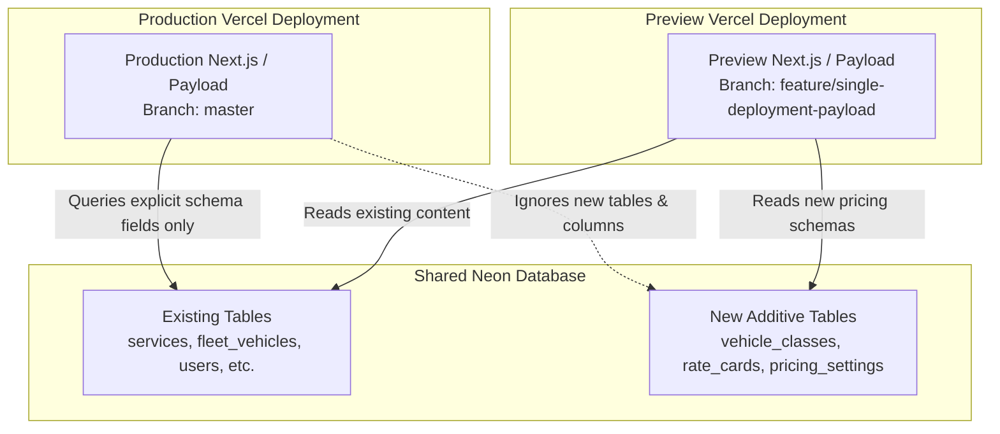
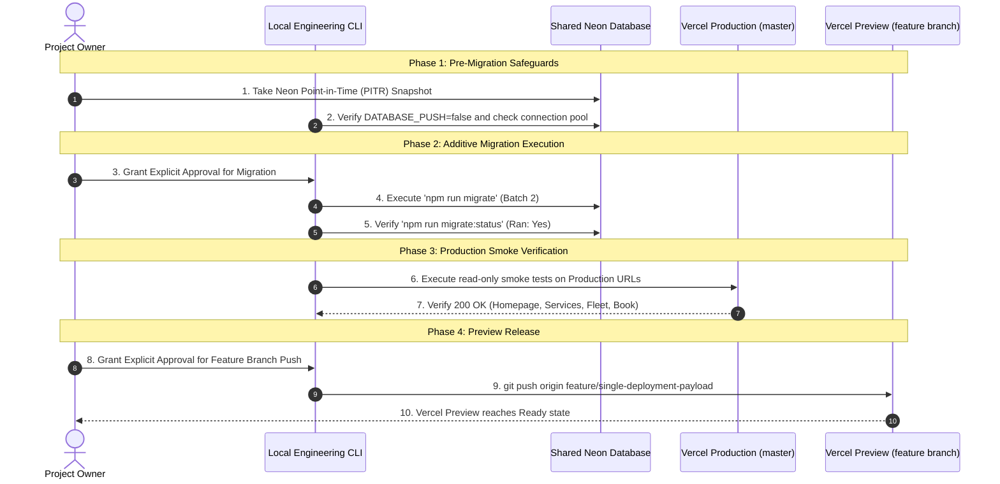

# Shared Database Migration Safety & Deployment Compatibility Audit

**Project:** Your Best Ride Inc.  
**Auditor:** Automated Engineering Verification Suite  
**Date:** October 22, 2026  
**Target Environment:** Shared Neon PostgreSQL Database (Production & Vercel Preview)  
**Migration Artifact:** [`apps/web/src/migrations/20261022_182542_add_pricing_engine.ts`](file:///c:/Users/Islah4/Desktop/Apps/YourBestRide/apps/web/src/migrations/20261022_182542_add_pricing_engine.ts)  
**Status:** Read-Only Technical Assessment & Release Procedure Plan

---

## 1. Executive Summary

The project owner has approved utilizing the same Neon PostgreSQL database for both Vercel Production and Vercel Preview deployments. 

In a shared database model, schema changes directly impact both environments simultaneously. This audit analyzes the backward and forward compatibility of migration `20261022_182542_add_pricing_engine.ts` against the live production schema, evaluates potential operational risks, verifies zero disruption to existing production traffic, and establishes a controlled release and rollback protocol.

---

## 2. Database Compatibility Analysis

### 2.1 Purely Additive DDL Classification
Every single SQL operation in `20261022_182542_add_pricing_engine.ts` has been audited against PostgreSQL DDL safety standards:

1. **New Standalone Tables (14 Total):**
   - Collections: `vehicle_classes`, `_vehicle_classes_v`, `rate_cards`, `_rate_cards_v`
   - Child Arrays: `rate_cards_routes`, `_rate_cards_v_version_routes`, `rate_cards_applicable_fees`, `_rate_cards_v_version_applicable_fees`, `rate_cards_fare_inclusions`, `_rate_cards_v_version_fare_inclusions`
   - Relationships: `rate_cards_rels`, `_rate_cards_v_rels`
   - Globals: `pricing_settings`, `pricing_settings_global_inclusions`
   - **Impact:** Zero impact on existing queries. These tables do not exist in the current production schema and are completely ignored by the current production application code.

2. **Additive Columns on Existing Tables:**
   - Table `services` & `_services_v`:
     - `pricing_display_show_pricing_on_page` (`boolean DEFAULT false`)
     - `pricing_display_pricing_headline` (`varchar NULL`)
     - `pricing_display_eligible_pricing_model` (`enum NULL`)
     - `pricing_display_show_starting_from` (`boolean DEFAULT true`)
     - `pricing_display_starting_from_note` (`varchar NULL`)
   - Table `fleet_vehicles` & `_fleet_vehicles_v`:
     - `vehicle_class_id` (`integer NULL`, with foreign key `REFERENCES vehicle_classes(id) ON DELETE SET NULL`)
   - Table `payload_locked_documents_rels`:
     - `vehicle_classes_id` (`integer NULL`)
     - `rate_cards_id` (`integer NULL`)

3. **No Breaking Modifications:**
   - No existing columns are renamed or dropped.
   - No existing data types are modified.
   - No `NOT NULL` constraints without defaults are added to existing tables.
   - No table rewrites: In modern PostgreSQL (11+), `ALTER TABLE ... ADD COLUMN ... DEFAULT <value>` executes as a sub-millisecond metadata update without rewriting table rows or locking reads/writes.

---

## 3. Production & Preview Cross-Compatibility

### 3.1 Behavior of Existing Production Code (Running on `master`)
- **Query Structure:** Payload CMS 3 and Drizzle ORM issue explicit `SELECT` field lists based on the collections registered in the running application instance.
- **Ignored Additions:** Because the running Production code does not have `VehicleClasses`, `RateCards`, or `PricingSettings` registered in its `payload.config.ts`, it never queries the new tables.
- **Column Immunity:** The newly added nullable columns on `services` (`pricing_display_*`) and `fleet_vehicles` (`vehicle_class_id`) are not requested in Production `SELECT` statements and do not interfere with standard CRUD operations or public page rendering.
- **Uptime:** Zero downtime. Existing public routes (`/`, `/services`, `/fleet`, `/locations`, `/drivers`, `/book`) continue functioning seamlessly.

### 3.2 Behavior of New Preview Code (Running on `feature/single-deployment-payload`)
- **Schema Expectation:** The new Preview code expects the pricing tables and columns to exist.
- **Admin Panel:** The Payload `/admin` UI in Preview will display "Vehicle Classes", "Rate Cards", and "Pricing Settings".
- **Customer Tariff Protection:**
  - Public `/rates-and-options` page is **not built** in Phase 1.
  - All existing `services` have `pricing_display_show_pricing_on_page` set to `false` by default.
  - The reconciliation gate ensures any rate card created in the CMS cannot be published without explicit Limo Anywhere verification metadata.
  - Public read access control strictly filters for `_status: 'published'` and `reconciliationStatus: 'active'`.
- **Clean State Compliance:** Per project requirement #7, no test or dummy CMS records will be created in the shared database. The collections will remain clean (0 records) until finalized, approved rate cards are introduced.

---

## 4. Critical Deployment Order Assessment

> [!IMPORTANT]
> **Why Database Migration Must Precede Preview Code Deployment:**  
> If the new Preview code is pushed to Vercel *before* the database migration is applied, the Next.js production build in Vercel will attempt to collect page data and initialize Payload against a database lacking `rate_cards` and `vehicle_classes`. This will throw PostgreSQL relation errors (`relation "rate_cards" does not exist`) and fail the deployment.  
> **Rule:** In an additive migration architecture, **Database Migration $\rightarrow$ Preview Deployment** is the strictly required, fail-safe order.

---

## 5. Controlled Release Procedure (Gate by Gate)

### Detailed Execution Steps:

1. **Step 1: Point-in-Time Recovery Baseline:**
   - Verify Neon PITR is active so the database can be restored to the exact second prior to DDL execution if required.
2. **Step 2: Pre-Flight Verification:**
   - Verify `DATABASE_PUSH=false` in the target environment.
   - Verify no write locks are held on `services` or `fleet_vehicles`.
3. **Step 3: Execute Additive Migration:**
   - Execute: `pnpm --filter @yourbestride/web migrate`
   - Verify output: `Migration 20261022_182542_add_pricing_engine executed successfully`.
4. **Step 4: Immediate Production Smoke Test:**
   - Verify `https://www.yourbestride.com/`
   - Verify `https://www.yourbestride.com/services` and service detail pages
   - Verify `https://www.yourbestride.com/fleet`
   - Verify `https://www.yourbestride.com/book`
   - Confirm zero error spikes in Vercel runtime logs.
5. **Step 5: Feature Branch Push & Preview Verification:**
   - With explicit owner approval, push `feature/single-deployment-payload`.
   - Monitor Vercel build log to confirm successful static generation.
   - Access Preview `/admin` to verify schema visibility.

---

## 6. Rollback & Contingency Plan

If any anomaly or constraint failure occurs after migration:

1. **Clean DDL Rollback:**
   - Execute: `pnpm --filter @yourbestride/web migrate:down`
   - The down-migration safely disables RLS, drops the 14 new pricing tables, removes the additive columns from `services`, `fleet_vehicles`, and `payload_locked_documents_rels`, and drops the enum types.
   - Existing tables, rows, and relationships remain completely intact.
2. **Catastrophic Recovery:**
   - In the event of network disruption or unrecoverable state, utilize Neon Point-in-Time Recovery to restore the database to the pre-migration timestamp.
3. **Preview Rollback:**
   - If Preview deployment exhibits unexpected behavior, Vercel allows instant rollback to the previous preview deployment with one click.
