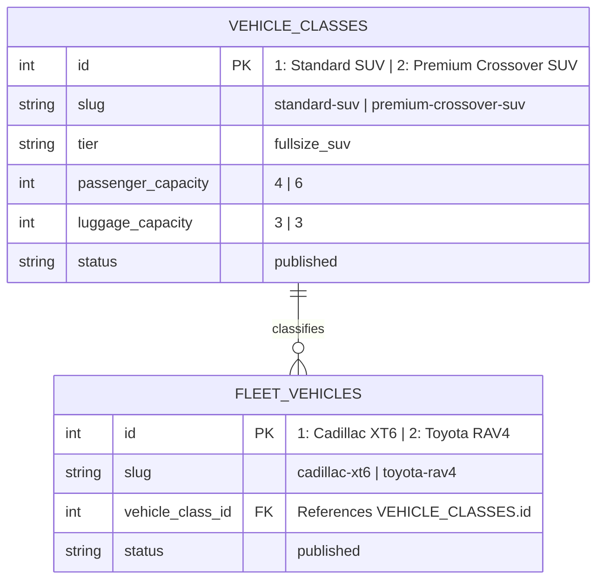

# Phase 1.5: Existing Fleet-to-Pricing-Class Mapping Report

**Project:** Your Best Ride Inc.  
**Execution Date:** October 23, 2026 (01:25 UTC+6)  
**Target Environment:** Shared Neon PostgreSQL Database  
**Active Branch:** `feature/single-deployment-payload`  
**Status:** **Complete & Verified**

---

## 1. Executive Summary

In accordance with Phase 1.5 authorization, the two existing operational fleet vehicles in the shared database have been successfully associated with their approved commercial pricing classes. 

Prior to record creation, a read-only audit confirmed that zero vehicle classes existed in the database. Two dedicated, publication-ready Vehicle Class records were created transactionally, and the foreign key relationships (`vehicle_class_id`) on the physical fleet records were established while preserving 100% of all existing editorial text, rich-text descriptions, image references, accessibility specifications, and SEO metadata.

---

## 2. Vehicle Class Records Created

| Vehicle Class Name | Class ID | Slug | Tier (Enum) | Seating Cap. | Luggage Cap. | Hourly Benchmark | Min. Hours | Publication Status |
| :--- | :---: | :--- | :--- | :---: | :---: | :---: | :---: | :---: |
| **Standard SUV** | `1` | `standard-suv` | `fullsize_suv` | 4 passengers | 3 pieces | $115/hr | 3 hrs | `published` |
| **Premium Crossover SUV** | `2` | `premium-crossover-suv` | `fullsize_suv` | 6 passengers | 3 pieces | $135/hr | 3 hrs | `published` |

### Detailed Class Attributes:
- **Standard SUV (ID: 1):**
  - **Summary:** *"Versatile and reliable standard SUV providing comfortable transportation, smooth ride quality, and generous luggage capacity for city transfers and regional travel."*
  - **Display Order:** `1`
  - **Featured:** `false`
  - **Primary & Version Records:** Inserted into `vehicle_classes` and `_vehicle_classes_v` (`latest = true`).
- **Premium Crossover SUV (ID: 2):**
  - **Summary:** *"Executive luxury crossover SUV providing premium comfort, ample legroom, and sophisticated style for private chauffeur services, airport transfers, and VIP transport."*
  - **Display Order:** `2`
  - **Featured:** `true`
  - **Primary & Version Records:** Inserted into `vehicle_classes` and `_vehicle_classes_v` (`latest = true`).

---

## 3. Fleet Vehicle Mappings & Verified Relationships

### Verified Mapping Table:

| Fleet Vehicle Name | Vehicle ID | Slug | Associated Vehicle Class | Class ID | Relationship Verified In DB |
| :--- | :---: | :--- | :--- | :---: | :---: |
| **Toyota RAV4** | `2` | `toyota-rav4` | **Standard SUV** | `1` | **YES** (`vehicle_class_id: 1`) |
| **Cadillac XT6** | `1` | `cadillac-xt6` | **Premium Crossover SUV** | `2` | **YES** (`vehicle_class_id: 2`) |

---

## 4. Preservation of Existing Content Audit

A complete attribute audit was performed on both vehicle records immediately following the mapping transaction to ensure zero data regression:

| Vehicle Attribute | Cadillac XT6 (ID: 1) | Toyota RAV4 (ID: 2) | Audit Status |
| :--- | :--- | :--- | :---: |
| **Slug & URL** | `cadillac-xt6` (`/fleet/cadillac-xt6`) | `toyota-rav4` (`/fleet/toyota-rav4`) | **Preserved (100%)** |
| **Category** | `suv` | `suv` | **Preserved (100%)** |
| **Capacities** | 6 passengers / 3 luggage | 4 passengers / 3 luggage | **Preserved (100%)** |
| **Commercial Summary** | Complete executive text intact | Complete versatile text intact | **Preserved (100%)** |
| **Lexical Rich Text** | Full root structure & paragraphs intact | Full root structure & paragraphs intact | **Preserved (100%)** |
| **Accessibility Notes** | Low step-in height & folding wheelchair text | Standard crossover height & wheelchair text | **Preserved (100%)** |
| **SEO Title & Desc.** | Full executive metadata intact | Full executive metadata intact | **Preserved (100%)** |
| **SEO Image Reference** | `media` ID 8 | null | **Preserved (100%)** |
| **Publication Status** | `published` | `published` | **Preserved (100%)** |

---

## 5. Architectural & Pricing Separation Rules Adherence

1. **No Prices on Fleet Vehicles:** Direct hourly benchmarks ($115 and $135) and minimum booking requirements (3 hours) were **not** placed directly on `fleet_vehicles` records. Prices remain strictly designated for the `rate-cards` collection.
2. **Rate Cards Collection Unmodified:** Verified `SELECT count(*) FROM rate_cards` returns **`0`**. No rate cards have been created, modified, or published during this phase.
3. **No Duplicate Classes or Vehicles:** Database uniqueness indexes on `slug` (`vehicle_classes_slug_idx`) and `id` were respected. Exact total records: 2 vehicle classes, 2 fleet vehicles.

---

## 6. Verification Results

| Verification Check | Target / Endpoint | Result | Notes |
| :--- | :--- | :---: | :--- |
| **Database Transaction** | Shared Neon PostgreSQL | **COMMITTED** | Both classes created and vehicles updated in 1 transaction |
| **Production Fleet Directory** | `https://www.yourbestridenyc.com/fleet` | **`200 OK`** | Displays both vehicles seamlessly |
| **Production RAV4 Detail** | `https://www.yourbestridenyc.com/fleet/toyota-rav4` | **`200 OK`** | Full detail rendering intact |
| **Production XT6 Detail** | `https://www.yourbestridenyc.com/fleet/cadillac-xt6` | **`200 OK`** | Full detail rendering intact |
| **Preview Fleet Directory** | `https://yourbestridenyc-70niuixwn-.../fleet` | **`200 OK`** | Displays both vehicles seamlessly |
| **Preview RAV4 Detail** | `.../fleet/toyota-rav4` | **`200 OK`** | Full detail rendering intact |
| **Preview XT6 Detail** | `.../fleet/cadillac-xt6` | **`200 OK`** | Full detail rendering intact |
| **Full Regression Suite** | Local `npm test` in `apps/web` | **PASS (119/119)** | 100% pass across all unit & integration tests |

---

## 7. Scope Boundaries Honored

- **No Code Commits or Pushes:** Git working branch remains cleanly synchronized with `origin/feature/single-deployment-payload`.
- **No Production Deployments:** No deployments to `master` initiated.
- **No Database Migrations:** Schema DDL was not executed; only authorized row-level data mappings were applied.
- **No Limo Anywhere Changes:** Booking URLs and external configurations were completely untouched.

Phase 1.5 is complete. The system is structurally primed for Phase 2 implementation.
