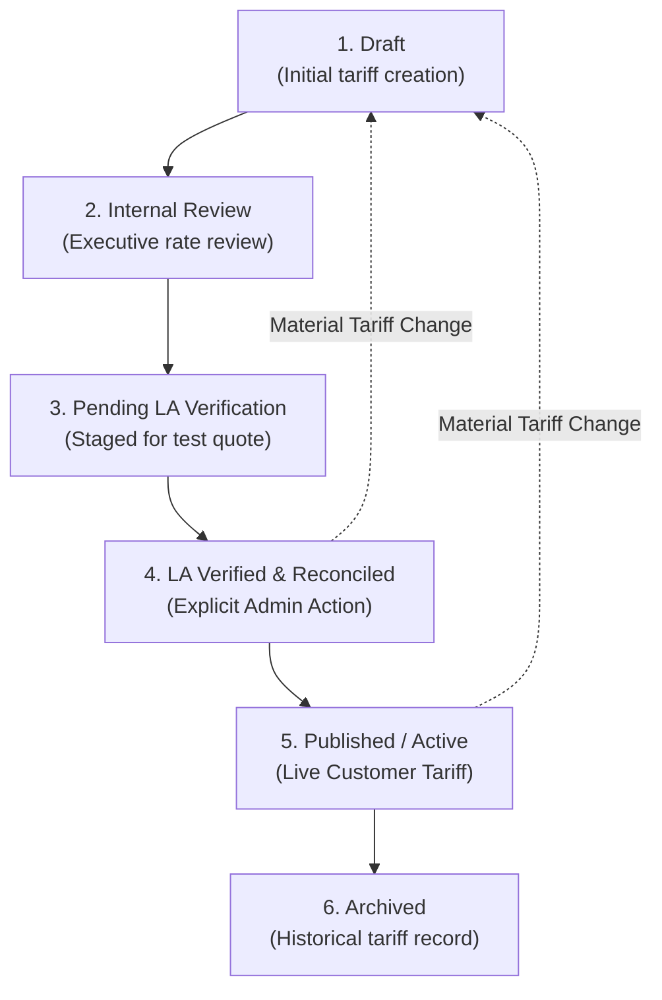

# Your Best Ride — 2026 Commercial Rate Cards & Tariff Architecture

**Document Version:** 1.0.0  
**Effective Year:** 2026  
**Backend:** Payload CMS 3 (PostgreSQL / Neon)  
**Booking Integration:** Limo Anywhere (LA) Universal Booking Engine  
**Access Classification:** Commercial Tariff Architecture & Administrative Reference  

---

## 1. Executive Summary & Core Pricing Principle

The foundational requirement of Your Best Ride Inc. is that **all customer-facing transportation prices and commercial tariffs are administrator-managed through Payload CMS**. Prices are never hardcoded into frontend components, nor is the pricing system replaced with an enquiry-only workflow.

Customer-facing tariffs are governed by a strict **Reconciliation & Audit Gate**:
- Rates are managed at `/admin` &rarr; **Rate Cards**.
- Prior to public activation, rate tariffs must undergo manual verification against Limo Anywhere test quotes.
- Only rate cards that achieve **`reconciliation.status = 'published'`** and **`_status = 'published'`** within an active effective date window are queried by the public frontend (`/rates-and-options`, service starting prices, fleet vehicle class links).
- Unverified, draft, or invalidated tariffs are strictly isolated from customer views.

---

## 2. Planned 2026 Rate Cards

The operational tariffs for 2026 encompass four core Rate Cards covering the primary commercial vehicle classes:

### Rate Card Schedule Summary

| Rate Card Title | ID | Vehicle Class | Pricing Model | Scope | Base Tariff Details | Minimum Terms | Current CMS Status |
| :--- | :---: | :--- | :--- | :--- | :--- | :--- | :--- |
| **Standard SUV — Hourly Chauffeur Rate 2026** | `1` | Standard SUV (ID: 1) | Hourly (`hourly`) | Global | **$115.00 / hour** | 3 hours ($345.00 min) | `draft` |
| **Premium Crossover SUV — Hourly Chauffeur Rate 2026** | `2` | Premium Crossover SUV (ID: 2) | Hourly (`hourly`) | Global | **$135.00 / hour** | 3 hours ($405.00 min) | `draft` |
| **Standard SUV — NYC Airport Transfers 2026** | `3` | Standard SUV (ID: 1) | Fixed Route (`fixed`) | Global | **JFK:** $175.00<br>**LGA:** $150.00<br>**EWR:** $185.00 | Point-to-Point Flat Rate | `draft` |
| **Premium Crossover SUV — NYC Airport Transfers 2026** | `4` | Premium Crossover SUV (ID: 2) | Fixed Route (`fixed`) | Global | **JFK:** $205.00<br>**LGA:** $175.00<br>**EWR:** $215.00 | Point-to-Point Flat Rate | `published` |

---

### Detailed Rate Card Specifications

#### 1. Standard SUV — Hourly Chauffeur Rate 2026 (Card ID: 1)
* **Vehicle Class:** Standard SUV (`standard-suv`, Seating: 4 passengers, Luggage: 3 pieces).
* **Hourly Rate:** $115.00 / hour.
* **Minimum Hours:** 3 hours consecutive ($345.00 minimum base charge).
* **Additional Hours:** $115.00 / hour billed in 15-minute increments ($28.75 / increment).
* **Scope:** Global tariff across NYC metropolitan region.
* **Included Amenities:** Complimentary bottled water, onboard Wi-Fi, flight tracking.
* **Lifecycle Status:** Draft (`reconciliation.status = 'draft'`). Requires LA test quote reconciliation before publishing.

#### 2. Premium Crossover SUV — Hourly Chauffeur Rate 2026 (Card ID: 2)
* **Vehicle Class:** Premium Crossover SUV (`premium-crossover-suv`, Seating: 6 passengers, Luggage: 3 pieces).
* **Hourly Rate:** $135.00 / hour.
* **Minimum Hours:** 3 hours consecutive ($405.00 minimum base charge).
* **Additional Hours:** $135.00 / hour billed in 15-minute increments ($33.75 / increment).
* **Scope:** Global tariff across NYC metropolitan region.
* **Included Amenities:** Complimentary bottled water, onboard Wi-Fi, luxury appointments, flight tracking.
* **Lifecycle Status:** Draft (`reconciliation.status = 'draft'`). Requires LA test quote reconciliation before publishing.

#### 3. Standard SUV — NYC Airport Transfers 2026 (Card ID: 3)
* **Vehicle Class:** Standard SUV (`standard-suv`).
* **Corridors & Flat Fares:**
  - **Manhattan &harr; John F. Kennedy International Airport (JFK):** $175.00 flat rate.
  - **Manhattan &harr; LaGuardia Airport (LGA):** $150.00 flat rate.
  - **Manhattan &harr; Newark Liberty International Airport (EWR):** $185.00 flat rate.
* **Additional Stop Fee:** $25.00 per en-route intermediate stop.
* **Lifecycle Status:** Draft (`reconciliation.status = 'draft'`). Requires LA test quote reconciliation before publishing.

#### 4. Premium Crossover SUV — NYC Airport Transfers 2026 (Card ID: 4)
* **Vehicle Class:** Premium Crossover SUV (`premium-crossover-suv`).
* **Corridors & Flat Fares:**
  - **Manhattan &harr; John F. Kennedy International Airport (JFK):** $205.00 flat rate.
  - **Manhattan &harr; LaGuardia Airport (LGA):** $175.00 flat rate.
  - **Manhattan &harr; Newark Liberty International Airport (EWR):** $215.00 flat rate.
* **Additional Stop Fee:** $25.00 per en-route intermediate stop.
* **Verification Proof:** Reconciled against Limo Anywhere Matrix Code: `Default Fixed Rate Matrix / MHT / PCSUV / JFK-LGA-EWR`.
* **Audit Metadata:** Verified by Administrator (User ID: 1) on `2026-10-23T12:46:07.215Z`.
* **Lifecycle Status:** **Published** (`_status = 'published'`, `reconciliation.status = 'published'`). Eligible for live customer presentation.

---

## 3. Disclosures, Surcharges & Commercial Policies

### 3.1 20% Limo Anywhere Standard Gratuity
In the primary Limo Anywhere operating configuration, an automated **20% chauffeur gratuity** is calculated on the net base fare for online bookings.
- **Frontend Presentation Rule:** Customer-facing tables on `/rates-and-options` display the **administrator-configured base tariff**.
- **Mandatory Consumer Disclosure:** Clear commercial notices state:
  > *"All displayed prices represent base tariffs. In accordance with luxury chauffeured industry standards, standard chauffeur gratuity (20%), state regulatory surcharges, airport authority access fees, and commercial bridge/tunnel tolls are itemized transparently during booking checkout."*
- **No Hidden Fees:** Customers are never presented with a surprise total; the booking checkout displays a full, itemized calculation before credit card authorization.

### 3.2 Statutory Mandates & Regulatory Surcharges
1. **NYS Congestion Surcharge (Tax Law § 1281):**
   - **Amount:** $2.75 per trip.
   - **Trigger:** Any for-hire transportation that begins, ends, or traverses Manhattan south of 96th Street.
2. **MTA Central Business District (CBD) Tolling:**
   - **Applicability:** Entries into Manhattan South of 60th Street during active tolling periods.
   - **Trigger:** Evaluated dynamically based on route geometry and vehicle commercial registration.
3. **PANYNJ Airport Access Fee:**
   - **Amount:** Commercial access surcharge mandated by the Port Authority of NY & NJ for pickups and drop-offs at JFK, LGA, and EWR.
4. **Commercial Crossing Tolls:**
   - **Billing Type:** Actual EZPass commercial toll pass-through for bridges and tunnels (Lincoln Tunnel, Holland Tunnel, Queens-Midtown Tunnel, RFK Bridge, George Washington Bridge, Verrazzano-Narrows Bridge).

### 3.3 Operating Policies & Grace Periods
* **Curbside Pickup Grace Period:** 15 minutes complimentary wait time from scheduled pickup.
* **Domestic Airport Flight Grace Period:** 30 minutes complimentary wait time from confirmed flight touchdown (tracked via real-time FAA flight radar).
* **International Airport Flight Grace Period:** 60 minutes complimentary wait time from confirmed flight touchdown.
* **Layover & Overtime Waiting Rate:** Pro-rated in 15-minute increments based on the applicable vehicle class hourly rate after expiration of grace period.
* **Late-Night / Early-Morning Window:** 23:00 to 05:00 (11:00 PM to 5:00 AM local time). Standard surcharge applies when scheduled within this window.
* **Deadhead Radius Threshold:** 35 miles from Manhattan staging radius before mileage return recovery applies.

---

## 4. Manual Limo Anywhere Reconciliation Workflow & Publication Lifecycle

To maintain complete parity between Payload CMS public advertising and the live Limo Anywhere dispatch system, rate cards follow a mandatory 6-stage lifecycle:



### Stage Definitions & Security Gates:
1. **1. Draft (`draft`):** Initial entry of rates, corridors, or hourly terms. Read-only audit stamps remain `null`.
2. **2. Under Internal Review (`internal_review`):** Management review of commercial profitability and seasonal adjustments.
3. **3. Pending LA Verification (`la_pending_verification`):** Assigned to dispatch operations to execute a test quote in Limo Anywhere.
4. **4. LA Verified & Reconciled (`la_verified`):**
   - **Explicit Administrator Action:** The authenticated administrator must explicitly transition the lifecycle state from an unverified state (`draft`, `internal_review`, or `la_pending_verification`) to `la_verified`.
   - **Derivation Server-Side:** The system automatically binds `verifiedBy = req.user.id` and `verifiedAt = new Date().toISOString()`.
   - **Anti-Forgery:** Both audit fields are `readOnly: true` in the schema. Client submissions attempting to set or forge these values are ignored.
   - **Anti-False Attribution:** Unrelated saves or draft edits on an existing unverified card demote it to `draft` rather than attributing unverified rates to the saving user.
5. **5. Published / Active (`published`):**
   - **Publication Gate:** Payload rejects publication (`_status = 'published'`) unless:
     1. `reconciliation.status === 'la_verified'` (or transitioning to published).
     2. Valid Limo Anywhere Reference Code is provided (minimum 3 characters).
     3. Verification Audit Notes detailing the test reservation quote are provided (minimum 10 characters).
     4. Verified administrator identity and timestamp are present.
     5. Dates do not conflict with an overlapping active global tariff.
6. **Material Change Invalidation Rule:**
   - Any modification to a commercially material field (vehicle class, service scope, services, pricing model, currency, effective dates, flat rates, hourly rates, mileage parameters, grace periods, fees) on an already verified or published card **immediately invalidates verification**, resets `reconciliation.status = 'draft'`, wipes audit stamps, and rejects immediate publication until renewed verification is completed.

---

## 5. Investigation: `/rates-and-options` Public Display Architecture

### 5.1 Root Cause of Empty Pricing on Previous Visits
When visiting `/rates-and-options`, customers previously observed vehicle classes rendered in the summary strip, but empty pricing cards for airport and hourly routes.

The investigation confirmed:
1. **Not a Frontend Bug:** The frontend components ([`RatesAndOptionsTabs.tsx`](file:///c:/Users/Islah4/Desktop/Apps/YourBestRide/apps/web/src/components/rates-and-options/RatesAndOptionsTabs.tsx)) and Next.js page correctly receive data from [`getRatesAndOptionsContent()`](file:///c:/Users/Islah4/Desktop/Apps/YourBestRide/apps/web/src/lib/cms/pricing-queries.ts#L137-L161).
2. **Not a Component Malfunction:** [`getVehicleClasses()`](file:///c:/Users/Islah4/Desktop/Apps/YourBestRide/apps/web/src/lib/cms/pricing-queries.ts#L40-L71) queries the `vehicle-classes` collection, where vehicle classes were published. Hence, vehicle classes were visible.
3. **Strict Query Isolation:** [`getActiveRateCards()`](file:///c:/Users/Islah4/Desktop/Apps/YourBestRide/apps/web/src/lib/cms/pricing-queries.ts#L111-L135) strictly filters:
   ```typescript
   where: {
     and: [
       { _status: { equals: 'published' } },
       { 'reconciliation.status': { equals: 'published' } },
     ]
   }
   ```
4. **Draft Rate Card State:** In the database, Rate Cards 1, 2, and 3 were in `_status = 'draft'` and `reconciliation_status = 'draft'`. Because no rate card was published at that time, `getActiveRateCards()` returned an empty array `[]`.
5. **Compliant Empty State:** In compliance with regulatory standards, when zero rate cards are published, the frontend presents a truthful empty state with **"Request a Custom Quote"** and **"Check Availability & Book"** CTAs rather than fabricating synthetic or draft prices.

### 5.2 Live Behavior with Published Rate Card ID 4
With Rate Card ID 4 published by the administrator:
- `getActiveRateCards()` retrieves Card ID 4.
- `mapEligibleRateCardsToContent` constructs the `fixedRoutes` dataset:
  - Manhattan &harr; JFK: **$205.00**
  - Manhattan &harr; LGA: **$175.00**
  - Manhattan &harr; EWR: **$215.00**
- `/rates-and-options` renders the full airport transfer pricing comparison table.
- Unpublished draft cards (Standard SUV Airport, Hourly Charters) remain gracefully protected until published by an administrator.

---

## 6. Unconfirmed Commercial Terms (Explicitly Non-Verified)

In accordance with compliance standards, the following commercial operational parameters are currently marked as **Unconfirmed & Non-Verified** pending operational sign-off:

| Commercial Parameter | Current Baseline | Status | Required Operational Action |
| :--- | :--- | :--- | :--- |
| **Child Safety Seat Fee** | $25.00 / seat | **Unconfirmed** | Confirm whether booster and forward-facing car seats are billed flat or provided complimentary on corporate accounts. |
| **Late Night Surcharge Window** | 23:00 – 05:00 ($20.00) | **Unconfirmed** | Verify whether Limo Anywhere auto-applies a late-night differential or if it is billed as a flat surcharge. |
| **VIP Airport Meet & Greet** | $65.00 flat add-on | **Unconfirmed** | Verify dispatcher staffing costs and terminal access permit fees for inside baggage claim greeting at JFK T4/T8. |
| **Out-of-Town Layover Hourly** | Standard vehicle class hourly | **Unconfirmed** | Confirm overnight chauffeur per diem and lodging allowances for multi-day itineraries outside the tri-state area. |
| **Commercial Holiday Surcharges** | $35.00 flat fee | **Unconfirmed** | Confirm official calendar of applicable major holidays (New Year's Eve, Thanksgiving, Christmas, Memorial Day, Labor Day, July 4th). |

*Note: These terms will not be published as active customer tariffs until verified in Limo Anywhere and authorized by company management.*
